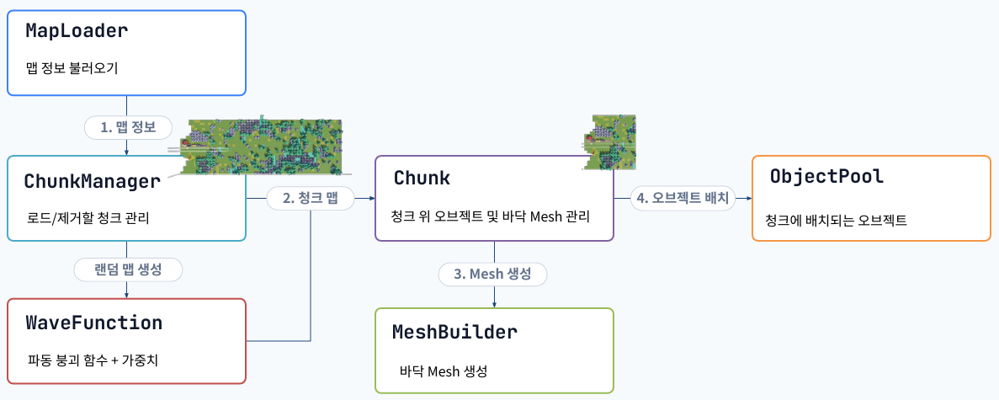
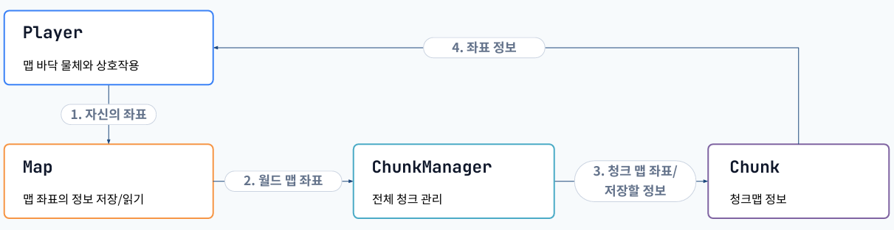

# 맵 로딩/저장

## 📝 1. 기능 개요

### 1.1. 기능 정의

- 스프레드 시트에서 맵 정보를 불러오거나 절차적 맵을 생성하여 청크 단위로 맵 저장

- 플레이어의 좌표를 자동으로 청크 인덱스 및 청크 좌표로 전환

### 1.2. 구현 목표
- 맵을 청크 단위로 관리하여, 청크별 오브젝트 로딩/제거가 가능

- 열차의 위치에 따라 일정 거리 이내의 청크만 스트리밍

---

## 🛠️ 2. 작성 클래스 설계 및 구조 

### 🔗 2.1. 클래스 간 관계도

## 핵심 클래스 세부 역할

 ### `MapLoader.cs`

  - **맵 시트에서 읽기 (`LoadMapDataRoutine()`)**: 스프레드 시트에서 맵 정보 받아오거나 UnityWebRequest가 timeout이면 저장된 맵을 불러오기

 

### `ChunkManager.cs`

  - **로드할 청크 결정 (`UpdateStreaming()`)**: Target이 위치한 청크 인덱스를 구하며 해당 인덱스의 일정 범위 내 청크만 로드, 나머지 청크는 제거

  - **청크 하나 로드 (`LoadChunkRoutine()`)**: 게임 모드에 따라 `WaveFunction`에게 랜덤 맵 생성을 시키거나 `MapLoader`의 맵을 `Chunk`에게 전달

  - **범위 밖 청크 제거 (`RemoveOldestChunk()`)**: 플레이어 시야에서 멀어진 청크 위 오브젝트를 오브젝트 풀로 반환하며, 청크 자체도 오브젝트 풀로 반환

 

### `WaveFunction.cs`

  - **절차적 맵 생성 (`StartWaveFunctionCollapse()`)**: 파동 함수 붕괴 알고리즘을 사용해 새 청크맵 생성

 

### `Chunk.cs`

- **오브젝트 배치 (`SpawnPoolObjects()`)**: 오브젝트 풀에서 오브젝트를 꺼내 청크 위에 배치

- **오브젝트 제거 (`DespawnPoolObjects()`)**: 청크를 제거할 때 청크 위 오브젝트를 오브젝트 풀로 반환

 

### `MeshBuilder.cs`

- **메쉬 생성 (`CreateChunkMesh()`)**: 입력된 정보에 따라 메쉬를 생성

 

---

### 🔄 2.2. 맵 로딩 흐름도 

 

## 단계별 세부 설명

### 1. 맵 정보 불러오기

- `MapLoader`가 스프레드 시트에서 맵 정보를 불러와서 `ChunkManager`에게 전달

  

### 2. 청크 맵 저장

### 1) 게임 모드: 빠른 모드, 무한 모드

- `ChunkManager`가 `WaveFunction`에게 청크맵 생성하도록 지시 (`CreateChunkMap()`)

### 2) 게임 모드: 시간 모드

- `MapLoader`가 전달한 월드맵을 청크맵으로 변환 (`WorldMapToChunkMap()`())

### 3. Mesh 생성

- `Chunk`가 `MeshBuilder`에게 Mesh를 생성하도록 정보 전달 (`CreateChunkMesh()`)

- 블록 종류에 따라 다른 색깔의 UV, 동일한 텍스처 아틀라스 사용

### 4. Object Pool에서 청크 위 오브젝트 배치

- `Chunk`가 청크맵을 순회하며 청크 인덱스가 0이면 레일 배치, 0이 아니면 승강장 레일을 배치

- 오브젝트 풀에서 오브젝트를 꺼내 배치

- 현재 청크 위에서 로드한 `IPoolable` 오브젝트를 `_loadedPoolables`에 저장

 

---

### 🔄 2.3. 플레이어 상호작용 흐름도 

 

## 단계별 세부 설명

### 1. 플레이어가 Map에게 자신의 좌표 전달

- 플레이어가 바닥 물체와 상호작용해서 들거나 배치할 때, 자신의 좌표를 `Map`에게 전달

- `GetHoldable()`, `SetHoldable()`로 들 수 있는 오브젝트 위치 맵에 접근 가능

### 2. Map이 ChunkManager 월드 맵 좌표 전달

- `Map`은 플레이어의 좌표를 `ChunkManager`에게 전달

### 3. ChunkManager가 Chunk에게 청크 맵 좌표 전달

- `Map`에서 월드 맵 좌표를 `Chunk`의 index, `Chunk`의 상대 좌표로 변환 (`GetChunkIndex()`, `GetChunkCoord()`)

- ChunkManager에서 해당 index를 가진 `Chunk`에게 접근

### 4. Chunk 맵 정보 읽기/쓰기 가능

- 플레이어가 `Map`만 참고해도 플레이어 위치의 `Chunk`의 청크 맵 정보를 읽거나 쓰기 가능

 