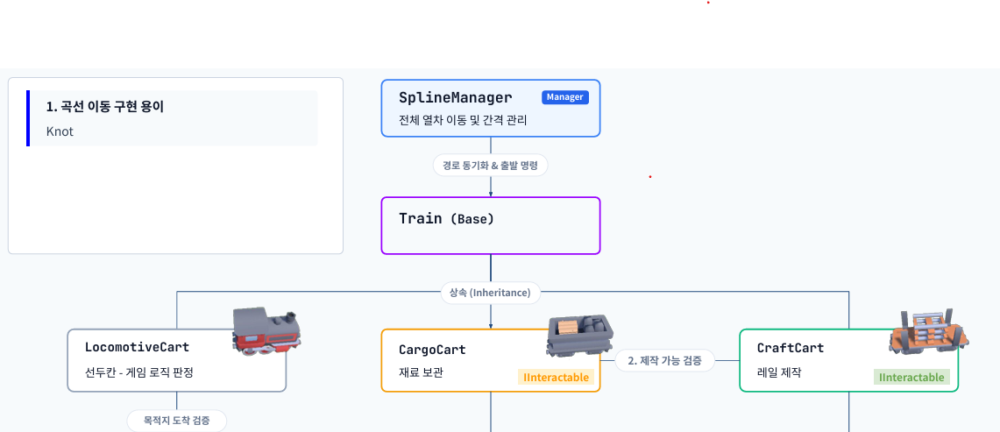

# 열차 움직임

## 📝 1. 기능 개요

### 1.1. 기능 정의

- 열차가 레일을 따라가면서 자동 이동

### 1.2. 구현 목표
- 열차가 레일을 따라 자동으로 이동

- 도중에 레일을 추가하거나 제거해도 열차는 수정된 경로를 따라 이동

---

## 🛠️ 2. 작성 클래스 설계 및 구조 

### 🔗 2.1. 클래스 간 관계도

## 핵심 클래스 세부 역할

### `SplineManager.cs`

  - **열차 이동경로 변경(`AddSplineKnot()`, `RemoveLastSplineKnot()`)**: SplineKnot를 추가/제거하여 열차의 이동 경로 변경

  - **열차 활성화 및 출발(`LoadTrain(), `TrainDepart()`)**: 열차를 활성화시키며, 일정 시간이 지나면 열차 출발

 

### `Train.cs`

  - **게임 클리어/오버 시 열차 모습 (`OnSplineUpdate()`)**: 게임 클리어 시 열차를 레일의 마지막 직전까지 이동시킨 다음 멈추게 만들며, 게임 오버(열차가 레일 끝에 도달할) 시 열차를 비활성화

  - **열차 출발 루틴 (`TrainDepartRoutine()`)**: 바로 출발하지 않고 일정 시간 기다린 뒤에 열차가 출발

  - **열차 오프셋 갱신 (`UpdateOffset()`)**: SplineKnot를 추가하면 열차의 위치가 변화하기 때문에, SplineKnot를 추가해도 열차의 위치가 변하지 않도록 오프셋 조정

 

### `LocomotiveCart.cs`

  - **레일 끝에 도달할 시 열차 도착 이벤트 발화 (`OnSplineUpdate()`)**: 레일 끝에 열차가 도달하면 게임 오버이므로, 맨 앞의 기관차에서 이벤트 발화

 

---

### 🔄 2.2. 열차 클래스 다이어그램

 

## 단계별 세부 설명

### 1. SplineManager가 Train의 이동 제어

- SplineManager가 Train의 활성화/비활성화, 열차 출발 등 이동에 관한 모든 것을 관할

### 2. Train의 열차가 이동하는 로직

- Train에서 열차가 SplineKnot를 통해 어떻게 움직이는지의 로직 전체를 보관

- 파생 클래스는 이동을 새롭게 구현할 필요 없이 Train을 상속받으면 해결

### 3. 레일 끝 감지

- `_splineAnimate.NormalizedTime`과 오프셋의 합이 1 이상인 경우, 레일의 끝에 도달하였기 때문에 게임 오버

- 맨 앞 기관차가 레일의 끝에 도달하면 게임 오버이므로, `LocomotiveCart`에 이벤트 추가
 