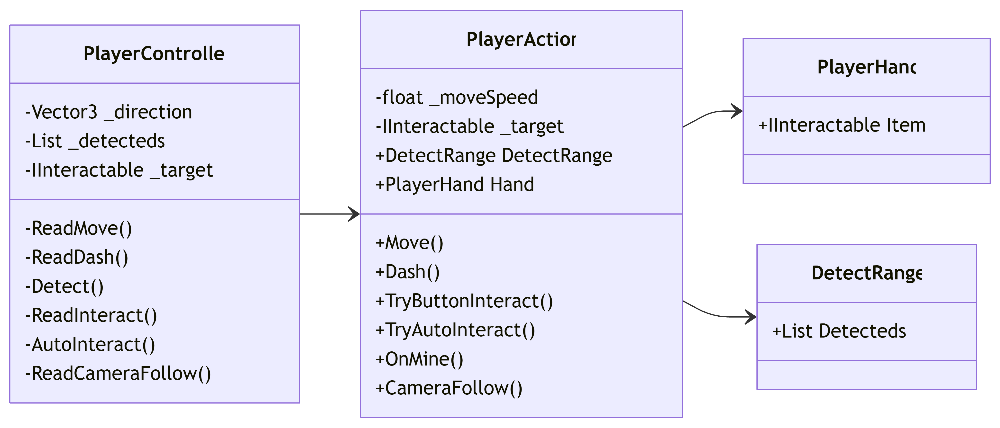

# Input System

## 📝 1. 기능 개요

### 1.1. 기능 정의

- 유저의 입력을 받아 행동하는 플레이어 클래스 작성

### 1.2. 구현 목표

- `WASD`키로 플레이어 이동
- `Space`키로 플레이어 상호작용
- `LeftShift`키로 플레이어 대쉬
- 상호작용 가능한 오브젝트 감지 및 선택
- 선택된 오브젝트와 상호작용

### 1.3. 클래스 설명

- `PlayerController`:
    - 유저의 입력을 받아 행동을 명령

- `PlayerAction`:
    - 플레이어의 행동 및 상태 관리

- `DetectRange`:
    - 감지된 오브젝트 저장

- `PlayerHand`:
    - 플레이어가 들고 있는 오브젝트 저장

## 🛠️ 2. 작성 클래스 설계 및 구조 

### `PlayerController`
- 감지된 오브젝트 중 상호작용 가능한 오브젝트 하나를 선택
- 유저의 입력을 바탕으로 `PlayerAction`에 명령을 전달

### `PlayerAction`
- `PlayerController`의 명령과 매개변수를 받아 행동

### `DetectRange`
- 감지된 오브젝트들을 리스트의 형태로 저장

### `PlayerHand`
- 플레이어가 들고 있는 오브젝트의 종류를 저장
- 저장된 오브젝트의 위치와 부모 관계를 반환

### 🔗 2.1. 클래스 간 관계도

### 🔄 2.2. 실행 절차 흐름
#### `PlayerController`
플레이어 조작
1. 유저의 입력을 감지
2. 입력에 해당하는 행동을 `PlayerAction`에 전달
    - `WASD`키 입력 시 이동 방향을 매개변수로 전달
    - `Space`키 입력 시 들고 있는 오브젝트를 매개변수로 전달

오브젝트 선택
1. 감지된 오브젝트의 내적값 계산
2. 오브젝트들의 선택 가능 조건 검사
3. 선택 가능한 오브젝트 저장
4. 우선 순위에 따라 저장된 오브젝트들 중 하나의 오브젝트를 선택

#### `PlayerAction`
플레이어 이동
1. 전달 받은 방향 벡터를 바라보도록 플레이어 회전
2. 플레이어 전진

플레이어 대쉬
1. `_canDash`가 `false`라면 종료
2. 플레이어의 `_canDash`를 `false`로 변경
3. 플레이어의 이동 속도를 대폭 증가
4. 대쉬 지속 시간 종료 후 이동 속도 복구
5. 대쉬 쿨다운 시간 후 `_canDash`를 `true`로 변경

플레이어 버튼 상호작용
1. 선택된 오브젝트 확인
    - 없다면 들고 있는 오브젝트 내려 놓기 및 들기 상태 종료
2. 전달 받은 오브젝트의 버튼 상호작용 메서드 호출
3. 호출한 메서드가 반환한 오브젝트 확인
    - 반환 받은 오브젝트가 선택된 오브젝트와 같다면, 들고 있는 오브젝트와 교환
    - 반환 받은 오브젝트가 선택된 오브젝트와 다르지만 들 수 있는 오브젝트이고 들고 있는 오브젝트가 없다면, 반환 받은 오브젝트 들기 및 들기 상태로 전환
    - 반환 받은 오브젝트가 들고 있는 오브젝트와 같다면, 버튼 상호작용 시도 종료

플레이어 자동 상호작용
1. 선택된 오브젝트 확인
    - 없다면 자동 상호작용 시도 종료
    - 자원이라면 채집 상태로 전환
    - 자원이 아니라면 선택된 오브젝트의 자동 상호작용 메서드 호출

#### `DetectRange`
1. 감지 범위 내로 들어온 오브젝트를 리스트에 저장
2. 감지 범위를 벗어난 오브젝트를 리스트에서 제거

#### `PlayerHand`
1. 들고 있는 오브젝트를 저장
2. 저장된 오브젝트의 종류, 위치, 부모 관계를 반환하는 프로퍼티 저장

## 🚨 3. 주요 이슈 및 디버깅 사례
### 플레이어 이동 사운드 이슈
#### 발생문제
플레이어가 이동을 멈추어도 이동 사운드가 곧바로 멈추지 않고 잠시 더 재생된 후 멈추는 문제

#### 원인 분석
애니메이션 이벤트로 이동 사운드를 재생하도록 하였는데, 이동 애니메이션에서 대기 애니메이션으로 자연스럽게 전환되는 사이에 해당 이벤트가 발생됨

#### 해결 방법
애니메이션이 전환되는 시간을 줄이고, 전환되는 시간에 사운드 재생 이벤트가 존재하지 않도록 이벤트 시점 조정